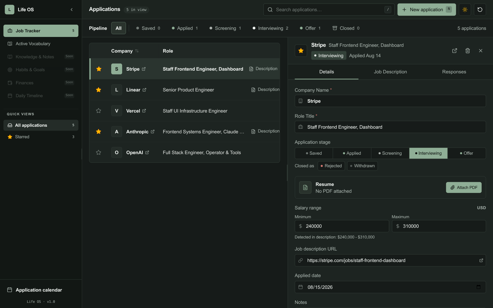
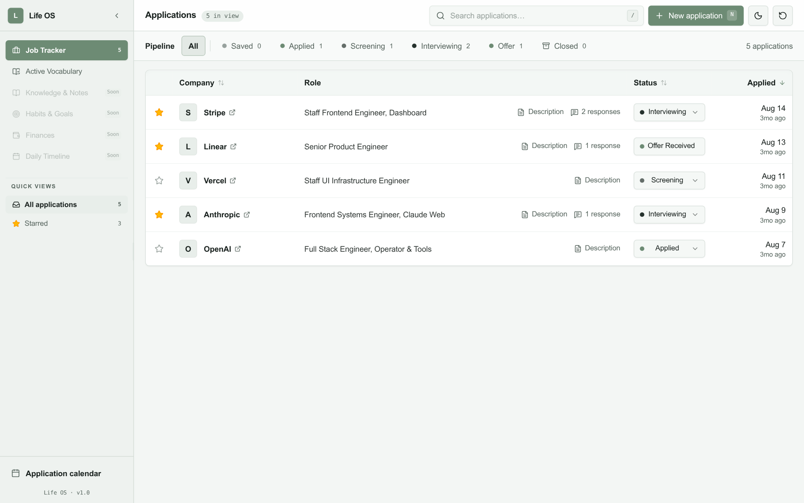
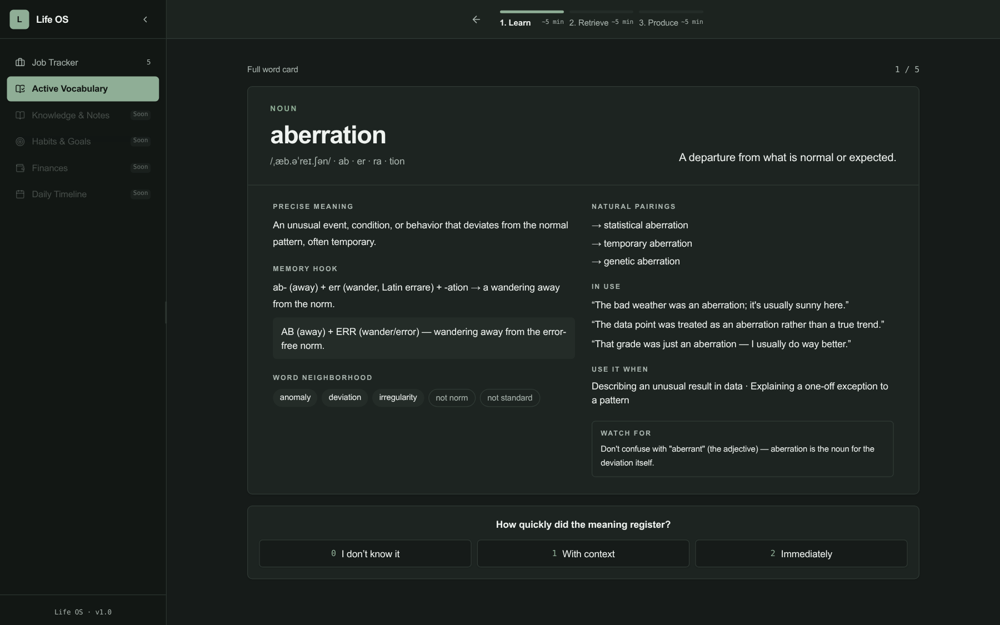

# Life OS

A personal dashboard for the parts of life that need tracking. Currently ships two modules:

- **Job Tracker**: pipeline of applications with job-description parsing, interview Q&A, and per-application resume PDFs.
- **Active Vocabulary**: GRE-style vocabulary trainer built on spaced repetition (FSRS).

Knowledge & Notes, Habits & Goals, Finances, and Daily Timeline are planned and appear in the sidebar as "Soon".


## Job Tracker



- Pipeline filters: Saved → Applied → Screening → Interviewing → Offer, plus Closed (Rejected / Withdrawn).
- Sortable table with stars, inline status changes, and a resizable detail panel.
- Paste a raw job description and it extracts salary range, experience level, and tech stack.
- Store interview questions and answers for each application.
- Attach the PDF resume you sent to each application.
- Starred view and an application calendar that filters by applied date.
- Light and dark themes.




### Keyboard shortcuts

| Key | Action |
|---|---|
| `N` | New application |
| `/` or `Ctrl/⌘ + K` | Focus search |
| `↑` / `↓`, `Enter` | Move through and open rows |
| `Space` | Star or unstar the focused row |
| `Alt + 1/2/3` | Details / Job Description / Responses tabs |
| `Ctrl/⌘ + Enter` | Save a new application |
| `Esc` | Close panel or modal |

## Active Vocabulary


- Keep up to 5 active words at a time. Recognition and retrieval are scored separately.
- Each session runs three stages: **Learn**, **Retrieve**, and **Produce**.
- Reviews are scheduled with [ts-fsrs](https://github.com/open-spaced-repetition/ts-fsrs).
- Word bank import is validated as a batch: if any profile is invalid, the whole file is rejected.




### Importing words

Go to **Word bank → Import JSON** and pick a file containing an array of word profiles. [`gre-words-50-import.json`](gre-words-50-import.json) is a ready-to-use set of 50 GRE words that shows the expected shape. The `WordProfile` type in [`src/types/vocabulary.ts`](src/types/vocabulary.ts) defines the schema.

## Roadmap

- **Database integration**: persistent storage and sync across devices.
- New modules: Knowledge & Notes, Habits & Goals, Finances, and Daily Timeline.

## Getting started

Requires Node.js 20.19+ or 22.12+ (Vite 8).

```bash
npm install
npm run dev       # http://localhost:5173
```

On first launch the job tracker is seeded with sample applications.

| Script | Purpose |
|---|---|
| `npm run build` | Type-check and build to `dist/` |
| `npm run preview` | Serve the production build |
| `npm test` | Run Vitest |
| `npm run lint` | Run Oxlint |

## Tech stack

React 19, TypeScript, Vite, Tailwind CSS v4, Radix UI / shadcn components, lucide icons, ts-fsrs, and Vitest.

## Project layout

```
src/
  components/
    jobs/         Job tracker table, filters, detail panel, JD modal
    vocabulary/   Dashboard, session flow, word bank
    resume/       PDF resume attachments
    layout/       Sidebar, header, app shell
    calendar/     Application calendar
    ui/           shadcn/Radix primitives
  lib/            Storage, JD parser, vocabulary service and validation
  types/          Domain types
```
