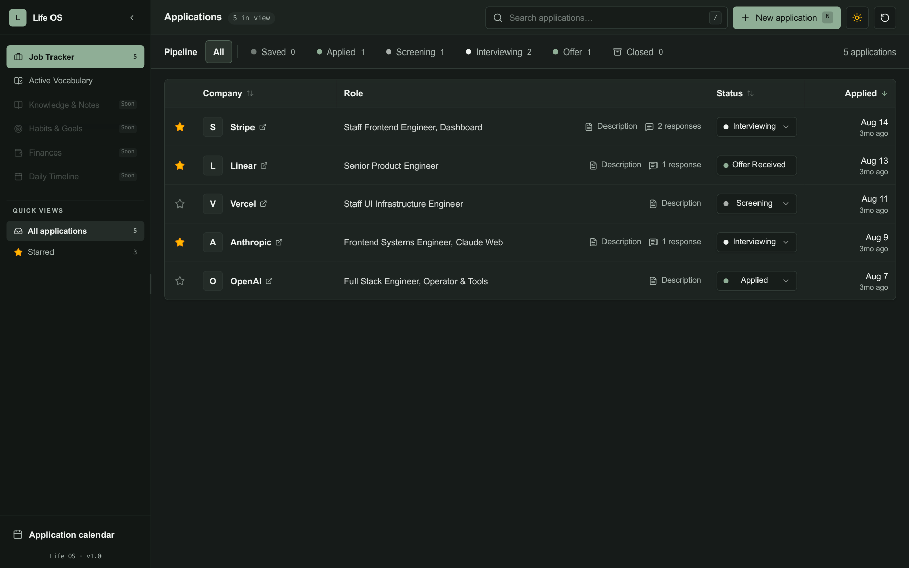
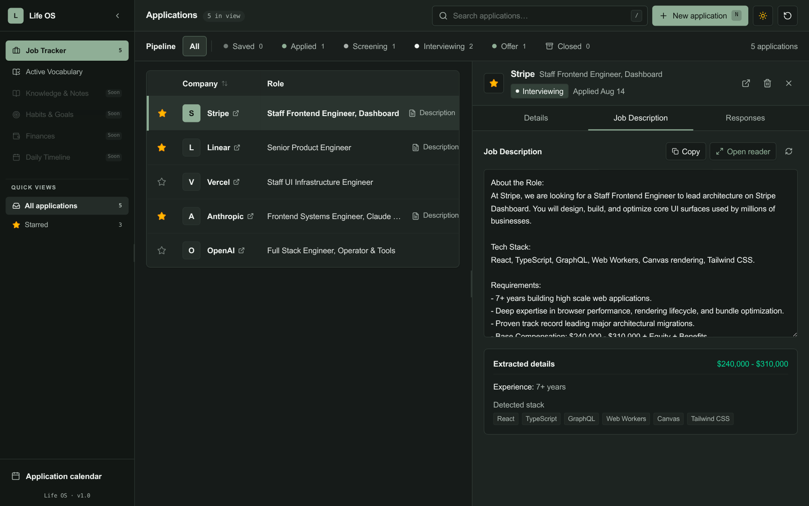
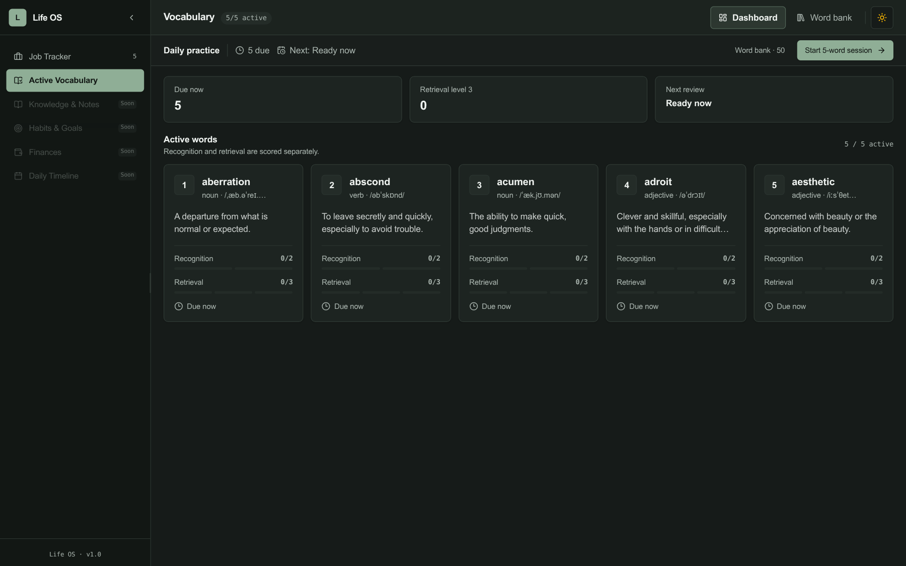
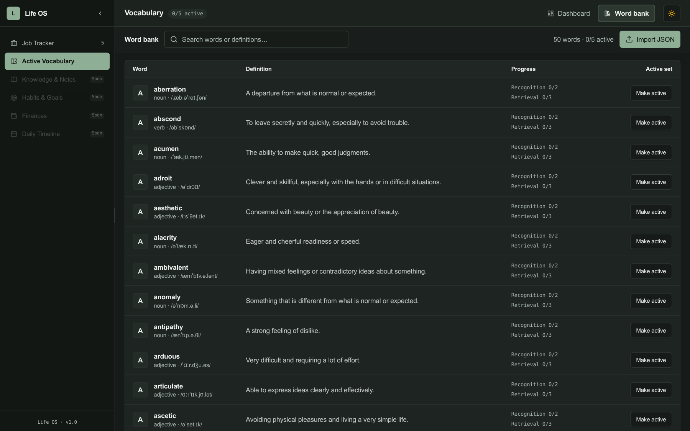

# Life OS

A personal dashboard for the parts of life that need tracking. Currently ships two modules:

- **Job Tracker**: pipeline of applications with job-description parsing, interview Q&A, and per-application resume PDFs.
- **Active Vocabulary**: GRE-style vocabulary trainer built on spaced repetition (FSRS).

Knowledge & Notes, Habits & Goals, Finances, and Daily Timeline are planned and appear in the sidebar as "Soon".

Life OS is built for agents too: an [MCP](https://modelcontextprotocol.io) server lets Claude Code, Claude Desktop, or any MCP-capable agent read and update your job pipeline. The dashboard is the human view of the same data.



## Job Tracker


- Pipeline filters: Saved → Applied → Screening → Interviewing → Offer, plus Closed (Rejected / Withdrawn).
- Sortable table with stars, inline status changes, and a resizable detail panel.
- Paste a raw job description and it extracts salary range, experience level, and tech stack.
- Store interview questions and answers for each application.
- Attach the PDF resume you sent to each application.
- Starred view and an application calendar that filters by applied date.
- Activity log on every application showing what changed and whether you or an agent changed it. Agent changes appear in the open dashboard within a couple of seconds.
- Light and dark themes.




### Keyboard shortcuts

| Key | Action |
|---|---|
| `N` | New application |
| `/` or `Ctrl/⌘ + K` | Focus search |
| `↑` / `↓`, `Enter` | Move through and open rows |
| `Space` | Star or unstar the focused row |
| `Alt + 1/2/3` | Details / Job Description / Responses tabs |
| `Ctrl/⌘ + Enter` | Save a new application |
| `Esc` | Close panel or modal |

## Agent access (MCP)

The MCP server (`server/mcp.ts`) runs over stdio and works on the same database as the dashboard.

| Tool | What it does |
|---|---|
| `list_jobs` | List applications, filtered by status, starred, or a text query |
| `get_job` | Full application: description, parsed metadata, notes, Q&A, resume, recent activity |
| `add_job` | Create an application; pass the posting text and salary, experience, and tech stack are extracted |
| `update_job` | Change status, details, salary, URL, or description |
| `append_note` | Add a dated line to an application's notes |
| `add_interview_answer` | Save an interview question and prepared answer |
| `attach_resume` | Attach a PDF from the local filesystem |
| `delete_job` | Delete an application (agents are told to confirm first) |
| `pipeline_summary` | Counts by status, stale applications to follow up on, recent activity |

It also exposes the resource `life-os://pipeline` with the same summary.

Replace `/path/to/life-os` below with the absolute path of your checkout. Run `npm install` first.

**Claude Code**

```bash
claude mcp add --scope user life-os -- /path/to/life-os/node_modules/.bin/tsx /path/to/life-os/server/mcp.ts
```

**Claude Desktop and other MCP clients** (`claude_desktop_config.json`, Cursor's `mcp.json`, and similar):

```json
{
  "mcpServers": {
    "life-os": {
      "command": "/path/to/life-os/node_modules/.bin/tsx",
      "args": ["/path/to/life-os/server/mcp.ts"]
    }
  }
}
```

If the repo lives in WSL and the client runs on Windows, launch it through WSL so Node comes from your login shell:

```json
{
  "mcpServers": {
    "life-os": {
      "command": "wsl.exe",
      "args": ["bash", "-lc", "/path/to/life-os/node_modules/.bin/tsx /path/to/life-os/server/mcp.ts"]
    }
  }
}
```

## Active Vocabulary



- Keep up to 5 active words at a time. Recognition and retrieval are scored separately.
- Each session runs three stages: **Learn**, **Retrieve**, and **Produce**.
- Reviews are scheduled with [ts-fsrs](https://github.com/open-spaced-repetition/ts-fsrs).
- Word bank import is validated as a batch: if any profile is invalid, the whole file is rejected.




### Importing words

Go to **Word bank → Import JSON** and pick a file containing an array of word profiles. [`gre-words-50-import.json`](gre-words-50-import.json) is a ready-to-use set of 50 GRE words that shows the expected shape. The `WordProfile` type in [`src/types/vocabulary.ts`](src/types/vocabulary.ts) defines the schema.

## Roadmap

- Agent tools for the vocabulary trainer.
- Remote MCP access over HTTP, with authentication, for phones and web clients.
- New modules: Knowledge & Notes, Habits & Goals, Finances, and Daily Timeline.

## Getting started

Requires Node.js 22.13+ (uses the built-in `node:sqlite`).

```bash
npm install
npm run dev       # dashboard and API at http://localhost:5173
npm run db:seed   # optional: load sample applications
```

Data is stored in a SQLite database at `~/.life-os/life.db`, with resume PDFs in `~/.life-os/resumes/`. Set `LIFE_OS_DATA_DIR` to use another directory; set it to the same value for the dashboard and the MCP server (`"env": { "LIFE_OS_DATA_DIR": "..." }` in client configs).

| Script | Purpose |
|---|---|
| `npm run build` | Type-check and build to `dist/` |
| `npm run preview` | Serve the production build (with the API) |
| `npm run mcp` | Run the MCP server on stdio |
| `npm run db:seed` | Load sample applications |
| `npm test` | Run Vitest |
| `npm run lint` | Run Oxlint |

## Tech stack

React 19, TypeScript, Vite, Tailwind CSS v4, Radix UI / shadcn components, lucide icons, ts-fsrs, SQLite (`node:sqlite`), the MCP TypeScript SDK, and Vitest.

## Project layout

```
server/
  db.ts           SQLite schema and data directory
  jobs.ts         Job store: validation and activity log, shared by the API and MCP server
  api.ts          JSON API for the dashboard (Vite plugin, dev and preview)
  mcp.ts          MCP server for agents
src/
  components/
    jobs/         Job tracker table, filters, detail panel, JD modal
    vocabulary/   Dashboard, session flow, word bank
    resume/       PDF resume attachments
    layout/       Sidebar, header, app shell
    calendar/     Application calendar
    ui/           shadcn/Radix primitives
  lib/            API client, JD parser, vocabulary service and validation
  types/          Domain types
```
